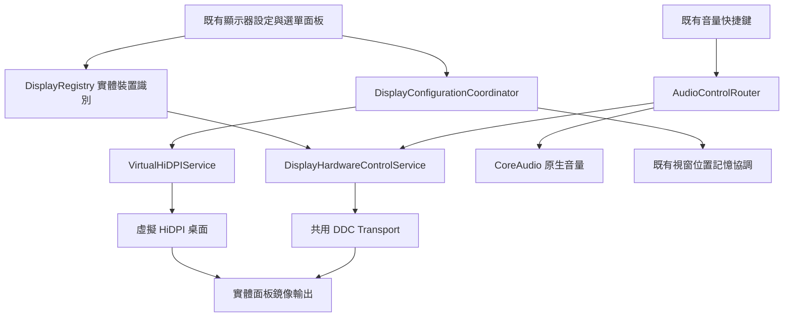

# HiDPI 與 DDC 整合研究及實作規劃

研究日期：2026-10-17。本文件保留研究時的設計與待驗收門檻；後續實作及實機結果見 [DISPLAY_INTEGRATION_VERIFICATION.md](DISPLAY_INTEGRATION_VERIFICATION.md)。

## 1. 決策與範圍

可以以 HiDPIScaler 的虛擬顯示核心，以及 MonitorControl 的 DDC 控制經驗為基礎，原生整合進「實用小工具」。使用者不需要另外安裝、啟動這兩款 APP；不嵌入它們各自的選單列、更新器、登入項目與快捷鍵服務。

依使用者最新指示，DDC 僅包含 **亮度、對比、音量、靜音**。輸入來源、電源、色彩、任意 VCP 編輯器均不在開發範圍。

「完整 HiDPI」的產品目標是：1080p、1440p 等外接顯示器也能選擇 2× 渲染的桌面，包括保持原有介面大小的 1920×1080、2560×1440 邏輯解析度，以及較大介面的縮放選項；涵蓋自訂尺寸、直向、多螢幕、重新連接與失敗復原。2× 渲染不會增加面板的實體像素，實際銳利度仍受面板與縮放影響。

不把「完整」解釋成每一種 Mac、轉接器、顯示器都必然支援。HiDPI 的 HDR、VRR、高更新率、色彩管理與受保護內容相容性，必須分別測試；DDC 的四項控制也必須逐項探測，不能由亮度可用推定音量可用。

## 2. 研究版本與授權

| 專案 | 本次檢查的固定版本 | 結論 |
| --- | --- | --- |
| [HiDPIScaler](https://github.com/txdadlab/HiDPIScaler/tree/1bfa4fa74ad54e03d3ee2b82c9418697289ccf4a) | `1bfa4fa74ad54e03d3ee2b82c9418697289ccf4a` | MIT；擷取 Objective-C 虛擬螢幕橋接與鏡像流程，重寫生命週期管理 |
| [MonitorControl](https://github.com/MonitorControl/MonitorControl/tree/7cfe64500d19cbbcbf82121a91c826f658a403bd) | `7cfe64500d19cbbcbf82121a91c826f658a403bd` | MIT；參考傳輸、裝置配對、佇列、靜音相容與喚醒處理，合併到既有顯示服務 |

MIT 允許修改與整合；實際引入原始碼時須保留原作者版權與完整授權文字，加入 ThirdParty 授權清單。只移植所需核心，不引入兩款 APP 的完整相依套件。私有 macOS API 的相容性與發行限制須獨立評估，開源授權不等於 Apple 對 API 的支援保證。

## 3. HiDPIScaler 原始碼結論

核心見 [CGVirtualDisplayBridge.m](https://github.com/txdadlab/HiDPIScaler/blob/1bfa4fa74ad54e03d3ee2b82c9418697289ccf4a/Sources/CGVirtualDisplayBridge/CGVirtualDisplayBridge.m)、[HiDPIState.swift](https://github.com/txdadlab/HiDPIScaler/blob/1bfa4fa74ad54e03d3ee2b82c9418697289ccf4a/Sources/HiDPIScaler/State/HiDPIState.swift)。

它宣告私有 `CGVirtualDisplay` 類別，建立可 HiDPI 渲染的虛擬顯示器，再讓實體螢幕鏡像該桌面。此路線不以寫入系統顯示 Override 或修改實體 EDID 為前提。橋接中鏡像函式的第一個 display 參數是被設定為鏡像跟隨者的實體螢幕；實作時必須明確命名，避免接反。

可重用的是建立、保留、銷毀虛擬顯示器的橋接及 CoreGraphics 鏡像操作。以下問題須先修正，不能原樣移植：

- `applySettings` 回傳失敗仍登記物件並回傳 display ID，可能誤報成功。
- 鏡像失敗時，虛擬 ID 尚未寫進狀態，錯誤清理可能漏掉剛建立的物件。
- 單一 session、固定虛擬 serial，以及保存短暫的 `CGDirectDisplayID`，不足以支援多螢幕及重接。
- 使用固定等待一秒判斷註冊完成；缺少啟用中狀態及取消機制，連點可能造成並行操作。
- 以目前邏輯尺寸推測原生解析度，且排除與其相同大小的預設，不能直接滿足「1080p 維持 1920 邏輯寬度」需求。
- 啟用流程固定 60Hz；尺寸上限未按 2× backing、GPU 與傳輸限制評估。
- 設定兩個 mode 後未明確驗證目前 mode 是否確為預期的邏輯尺寸及雙軸 2× backing。
- 停用時解除鏡像，不等於恢復使用者原有的鏡像、主螢幕、排列與模式；退出清理也不足以處理當機。

因此定位為「可編譯的技術起點」，不能直接承諾成熟完整支援。橋接必須在執行時檢查私有類別與 selector 可用性，不可因 API 缺失使整個工具 APP 無法啟動。

## 4. MonitorControl 與現有 DDC 的整合

核心參考 [Arm64DDC.swift](https://github.com/MonitorControl/MonitorControl/blob/7cfe64500d19cbbcbf82121a91c826f658a403bd/MonitorControl/Support/Arm64DDC.swift)、[OtherDisplay.swift](https://github.com/MonitorControl/MonitorControl/blob/7cfe64500d19cbbcbf82121a91c826f658a403bd/MonitorControl/Model/OtherDisplay.swift)。

| 控制 | VCP | 整合要求 |
| --- | --- | --- |
| 亮度 | `0x10` | 保留目前實體 DDC 與軟體調暗能力，介面明確區分兩者 |
| 對比 | `0x12` | 逐裝置探測，只在支援時提供滑桿；不以 gamma 假造硬體對比 |
| 音量 | `0x62` | 依實際最大值與最小步進換算百分比，與目前音訊輸出配對 |
| 靜音 | `0x8D` | 優先原生控制；不支援時才以音量歸零並保存原音量實現替代 |

MonitorControl 提供 Apple Silicon IOAVService 與 Intel framebuffer 路線、讀寫節流、合併連續寫入及顯示器差異處理。現有 `BrightnessService` 已具備大量相同基礎，應抽取共用 transport，避免兩套服務同時向相同顯示器發送指令。第一階段以 Apple Silicon 驗證；既有其他架構相容路徑予以保留，不為此另開新平台工作。

### 協定修正是前置工作

本次原始碼檢查發現，MonitorControl 的 ARM GET 封包與目前 `BrightnessSupport.packet` 都在單位元組讀取請求的 checksum 中省略來源位址 `0x51`。不能直接複製此實作當成正確性依據。對照獨立實作 [ddcutil 封包產生程式](https://github.com/rockowitz/ddcutil/blob/master/src/base/ddc_packets.c)，標準請求應把目的與來源位址都納入 checksum。

IOAVService 子位址另傳 `0x51` 時，預期送出的 GET 資料範例是：亮度 `82 01 10 ac`、音量 `82 01 62 de`、靜音 `82 01 8d 31`。SET 目前的 checksum 路線無此差異。後續需用獨立封包 fixture 與實機讀回共同驗證；ddcutil 僅作協定參考，不引入 Linux 相依程式碼。

回覆解析必須驗證來源、長度、opcode、result、所請求的 VCP code 與 checksum，將「不支援」「無回覆」「格式錯誤」分開。現有 parser 未檢查 result，不能把 unsupported 回覆解讀成成功。標準封包優先；若確有裝置需要舊格式，只在無回覆或格式錯誤時有限嘗試，對明確 unsupported 不反覆重試。

狀態分成 requested、writeAccepted、readbackConfirmed。系統 API 接受寫入，不等於顯示器已套用；可讀回時確認，無法讀回則如實顯示，不能保存要求值後就宣稱成功。各項功能分別保存範圍、支援與確認狀態；未知最大值不能一律當作已證實的 100。

USB-C/DP、HDMI、Dock 與 Mac 型號會影響 DDC 傳遞；DisplayLink 等路徑可能只有軟體亮度。軟體調暗不能替代硬體音量或對比。四項功能的不可用狀態須個別呈現。

## 5. 統一架構

### DisplayRegistry

以 EDID 廠商、產品、serial／hash 及必要的連接路徑建立實體識別；同型號且沒有 serial 的雙螢幕必須保守配對，無法唯一辨識時要求使用者重新綁定。暫時的 display ID 不持久化為唯一識別。

每個實體裝置記錄 physical display ID、目前桌面 ID、自有 virtual ID、DDC endpoint 與 audio device UID。採用 online 實體裝置圖，不能只列 active desktop 而漏掉鏡像跟隨者。所有 DDC 指令始終送到實體裝置，HiDPI 模式切換只作用於對應桌面。

### DisplayConfigurationCoordinator / VirtualHiDPIService

每個實體裝置以狀態機處理 idle → preparing → virtualCreated → mirroring → awaitingConfirmation → active；任一步失敗進入 rollback／failed。同一交易串行，拓樸世代變更時取消過期操作。優先使用系統已提供的原生 HiDPI mode，缺少時才啟用虛擬路線。

切換前保存原模式、鏡像關係、主螢幕及排列；每個物件在建立當下即取得清理責任。使用拓樸回呼與實際 mode 檢查取代固定 sleep。驗證邏輯與 backing 尺寸、長寬比、旋轉及刷新率，確認後才保存設定。

首次切換提供 15 秒「保留設定」倒數；超時恢復。獨立非 root 的復原 watchdog 與交易日誌必須能處理主程式失去回應，並對 helper 自身失效及主程式被強制終止測試。不能以「虛擬物件會隨程序消失」推定原排列一定回復。關閉功能及卸載時僅清理本 APP 擁有的物件。

每個實體裝置配置穩定且不同的虛擬 serial；螢幕消失時停止其 session，不替換成另一台主螢幕。自訂尺寸需限制整數溢位、最大 backing、長寬比與渲染負擔。先完成 SDR 60Hz，再逐機驗證其他刷新率與 HDR 等能力。

### DisplayHardwareControlService / AudioControlRouter

四項 VCP 共用目前亮度服務的傳輸與節流，依實體裝置＋VCP 合併待寫值；拓樸改變後拒絕舊 endpoint 的排隊指令。休眠／重接先重新建立路徑，有限重試與延遲，避免持續喚醒或阻塞介面。

音量鍵先使用可調整的 CoreAudio 輸出；HDMI／DP 音訊輸出沒有原生音量時，路由至明確綁定的實體螢幕 DDC。裝置名稱相似只能作建議，不能默默當成唯一證據。無法配對或控制失敗時保留按鍵正常傳遞。硬體螢幕音量與逐 APP 混音是不同控制，兩者可共存。

## 6. 現有程式落點

| 現有檔案 | 變更方向 |
| --- | --- |
| `Services/Display/BrightnessService.swift`、`BrightnessSupport.swift` | 抽取 DDC transport 與實體路由，修正封包及 parser；保留現有亮度偏好 |
| `UI/MenuPanel/BrightnessSection.swift` | 擴充實體螢幕卡片；亮度、音量、靜音作常用控制，對比放展開項 |
| `UI/Settings/EnergySettings.swift` | 擴充目前顯示器區，納入 HiDPI、邏輯解析度、刷新率、各控制支援狀態；沿用搜尋與設定入口 |
| `Services/Audio/PreciseVolumeRollerService.swift` | 接入 AudioControlRouter，重用既有媒體鍵攔截，避免第二套 tap |
| `Services/Audio/AppVolumeMixer.swift` | 使用既有輸出 UID／CoreAudio 能力資訊，保留逐 APP 混音邏輯 |
| `Services/Notch/NotchService.swift`、既有 BrightnessOSD | 統一原生／DDC 的音量亮度事件與 OSD，避免重複彈出 |
| `Services/WindowLayout/DisplayWindowMemoryService.swift` | HiDPI 交易期間暫停學習及還原；穩定後把虛擬桌面映射回實體顯示器，避免錯誤保存暫態排列或拉回使用者視窗 |
| `Core/FeatureCatalog.swift`、`App/FeatureRuntime.swift` | 原生功能註冊、按需啟動與關閉清理，避免以 runtime 外掛另開一套生命週期 |
| `Core/SettingsBackupSupport.swift` | 備份使用者意圖；排除本機 endpoint、暫時 ID 與交易日誌；跨機還原需重新綁定 |
| `Package.swift`、`build.sh` | 同時加入 Objective-C bridge 的編譯與連結，不能只修改 SPM |

表中程式路徑皆相對於 `Sources/Vorssaint/`，最後一列除外。正式 `build.sh` 使用自訂 `swiftc` 與 Swift 檔案清單，現狀不會自動編譯新 `.m`。需加入獨立 clang object／library、header／modulemap、CoreGraphics／Foundation 連結及一致 SDK／架構參數。橋接保留其非 ARC 設定；保留既有 helper 編譯、簽章與封裝管線。

## 7. 使用者操作

設定中依實體螢幕顯示卡片：名稱、HiDPI 開關、介面大小預設及目前刷新率；展開後可選自訂尺寸與對比。1080p 提供 1920×1080 HiDPI，1440p 提供 2560×1440 HiDPI，不把它們誤當成不需要的原生選項。卡片不因建立虛擬螢幕而變成兩台裝置。

選單面板沿用目前亮度入口並加入音量與靜音；只有確認或明確啟用的可用控制才可操作。HiDPI 初次切換顯示倒數確認，成功後才記住；重接時只恢復同一台已綁定螢幕。使用者日常不需處理 IOAV、VCP 或虛擬 ID。系統顯示設定仍可能列出虛擬螢幕，不承諾能從 macOS 全域隱藏。

權限按實際能力請求：虛擬建立與鏡像流程不使用畫面擷取，不因這個功能自行要求螢幕錄製權限；媒體鍵／視窗控制沿用既有權限流程。此方案不新增寫入系統 Override 的管理員操作。

## 8. 建議實作順序與完成門檻

1. **共用基礎與 DDC 四項控制。** 建立 DisplayRegistry，修正封包及回覆解析，抽取 transport；先保留現有亮度行為，再加入對比、音量、靜音與明確音訊綁定。完成門檻：四項逐裝置讀寫／失敗狀態正確，既有快捷鍵與混音不退步。
2. **單一外接螢幕 HiDPI。** 引入修正後橋接、SDR 60Hz、原生尺寸 2× 預設、交易與倒數復原；兩條建置管線均可編譯。完成門檻：1080p／1440p 實機證明邏輯尺寸與雙軸 backing 符合預期，所有中途失敗都清掉自有虛擬物件並還原。
3. **生命週期與多螢幕。** 自訂／直向、多台含同型號螢幕、睡眠／喚醒、拔插／Dock／重啟，協調視窗位置記憶，實測 watchdog。完成門檻：不控制錯台、不保存暫態桌面、關閉功能不遺留錯誤鏡像。
4. **整合驗收與發行。** 完成介面、設定遷移、備份排除、MIT notices、簽章與安裝後驗證；依實測開放較高刷新率等能力。不能用編譯成功代替硬體功能驗收。

必要測試包括：獨立協定 fixture（有效／unsupported／錯誤 code／損壞 checksum）、寫入合併與世代取消、逐步注入 HiDPI 建立／套用／鏡像失敗、倒數超時、APP 強制終止、多台同型號識別、靜音前值恢復與原生音訊切換。

硬體矩陣至少涵蓋 1080p、1440p；USB-C／DP 直連與 HDMI；Dock 及已知不支援 DDC 的負案例。4K、超寬與直向作擴充驗收。音量實際變化與畫面可用性需實機觀察，API 回傳或讀回數值僅是其中一層證據。

## 9. 本輪驗證與界線

已下載兩個固定版本並檢查核心原始碼，對照目前 APP 的顯示、音訊、快捷鍵、設定、建置與視窗位置記憶程式。HiDPIScaler 在研究 checkout 執行 `swift build -c release` 成功（10.20 秒）；這只證明此機器可編譯該版本，不代表虛擬顯示或鏡像實機成功。

本輪沒有執行其 APP、建立虛擬螢幕、寫入 DDC、修改顯示設定或恢復 BetterDisplay 逆向實驗。只新增本規劃文件，既有產品程式與未提交工作均保留。

評估：目前已有足夠依據開始第 1 階段。兩個開源專案提供核心技術來源，主要工程量落在穩定識別、協定正確性、拓樸交易／復原及既有功能協調；並非把兩個專案整包放進 APP 即可完成。
